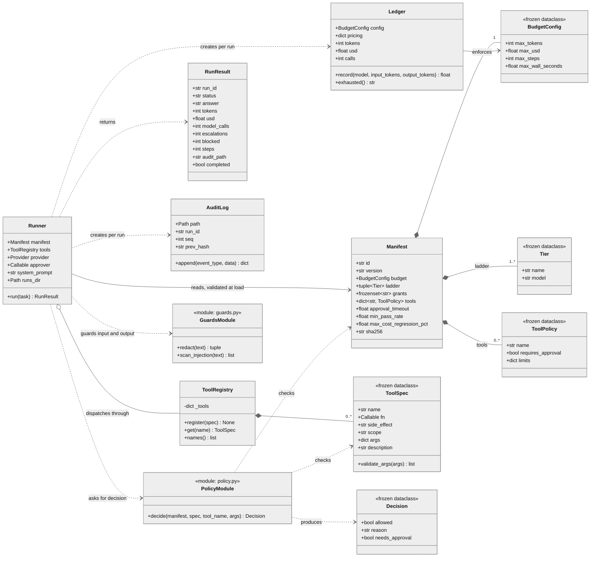
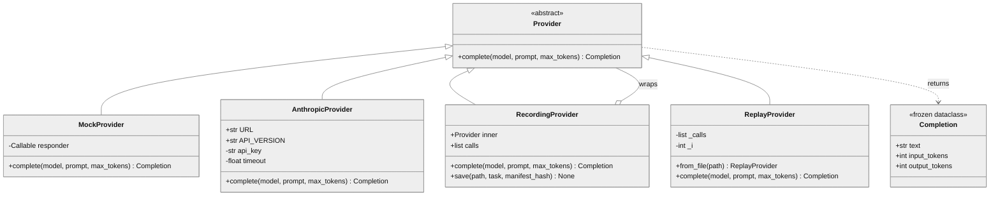
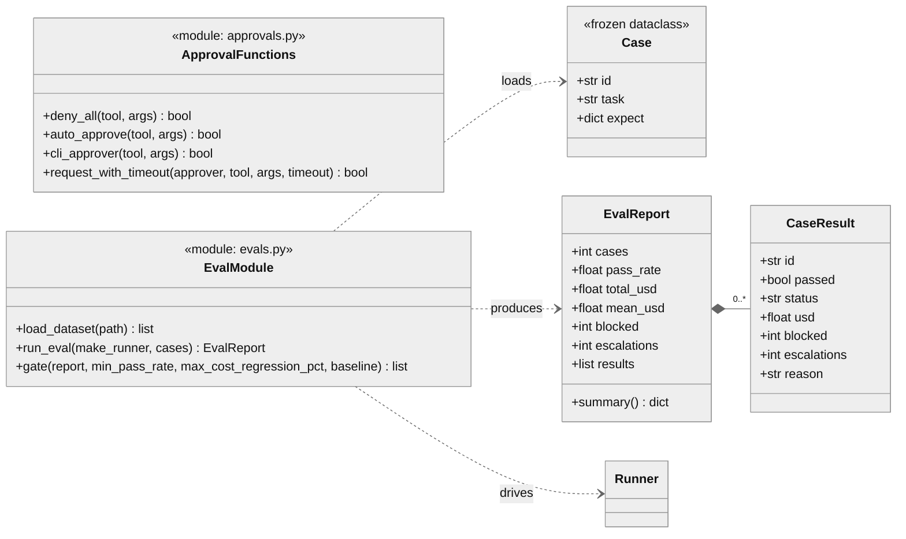
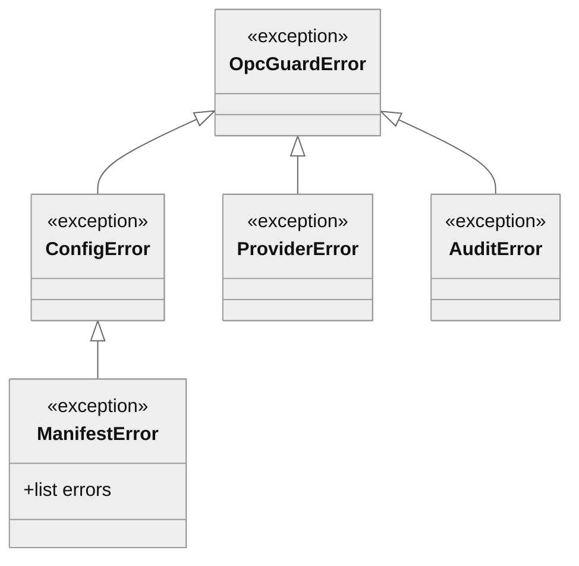

# 1. Class diagram

Static structure of `src/opc_guard/`. Shows the core domain types, the provider hierarchy,
and the evaluation types. Private helpers and internal state are omitted for clarity.

## Core domain

Mermaid source (editable)

## Providers

Mermaid source (editable)

## Approvals and evaluation

Mermaid source (editable)

## Error hierarchy

Mermaid source (editable)

## Notes

- **Immutability:** `Manifest`, `Tier`, `ToolPolicy`, `BudgetConfig`, `ToolSpec`, and `Decision` are frozen. Enforces ADR-004 (no policy mutation during a run).
- **Per-run state:** `Ledger` and `AuditLog` are created inside `Runner.run()`. Each run starts with a fresh budget and a fresh hash chain.
- **Dependency direction:** the runner depends on abstractions (`Provider`, `Callable` approver). Providers never import the runner.
- **Modules shown as classes** (`PolicyModule`, `GuardsModule`, `EvalModule`, `ApprovalFunctions`) are free functions in the source. They are drawn as stereotyped classes for diagram consistency.
