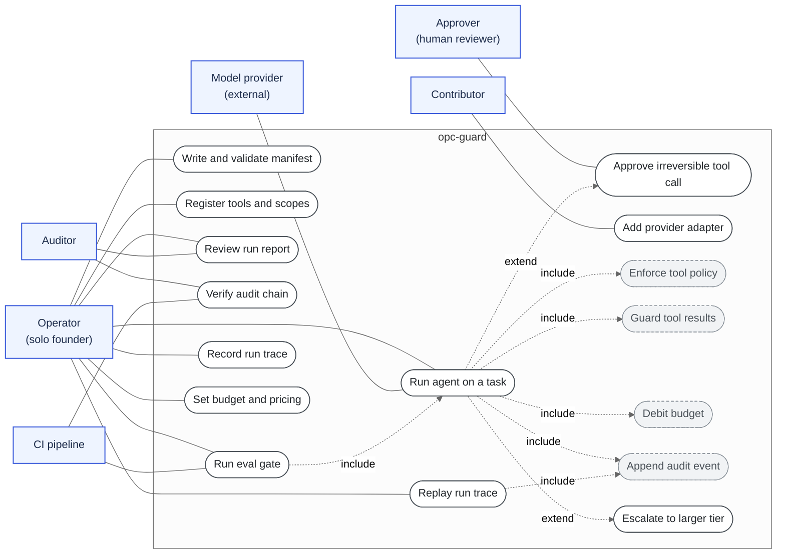

# 2. Use case diagram

Who uses opc-guard, and what they can do with it. The system boundary is the `opc-guard`
box. Dashed arrows show `<<include>>` (always happens) and `<<extend>>` (happens only under a condition).

## Overview

Mermaid source (editable)

## Use case specifications

| ID | Use case | Primary actor | Trigger | Outcome |
|---|---|---|---|---|
| UC1 | Write and validate manifest | Operator | New or changed agent | Manifest accepted, or every error listed at once (`opc-guard validate`) |
| UC2 | Register tools and scopes | Operator | New capability needed | Tool in registry and granted scope in manifest |
| UC3 | Run agent on a task | Operator | `opc-guard run` | `RunResult` with status, cost, blocks, and audit path |
| UC4 | Approve irreversible tool call | Approver | Tool requires approval | Approval recorded; denied on timeout |
| UC5 | Review run report | Operator, Auditor | After a run | Model calls by tier, denials, approvals, guard hits |
| UC6 | Verify audit chain | Auditor, CI | Before trusting a log | `OK` or the first broken line |
| UC7 | Run eval gate | CI, Operator | Pull request or manual | Pass or fail on pass rate and cost regression |
| UC8 | Record run trace | Operator | Debugging or reproducing | Trace file with every model output |
| UC9 | Replay run trace | Operator, CI | Reproduce without cost | Same answer with zero live model calls |
| UC10 | Add provider adapter | Contributor | New model vendor | Adapter implements `Provider.complete` |
| UC11 | Set budget and pricing | Operator | Spend policy change | Limits in manifest, prices in `budget.py` |

## Scope notes

- **Model provider** is an external actor. It is only reached through UC3 and never sees the
  tool registry or policy rules.
- **Approver** may be a person at a terminal (`cli`), an automated stub for demos (`auto`),
  or a deny-all default. Production use should always involve a person.
- **Auditor** needs read access to logs but no write access. The hash chain makes after-the-fact edits detectable.
