# 4. Activity diagram

Control flow for one `Runner.run()` call, from task to terminal status. Each node is
annotated with the module that owns it. Every terminal state is written to the audit log
before the process returns.

```mermaid
%%{init: {"theme": "neutral", "flowchart": {"curve": "basis", "nodeSpacing": 30, "rankSpacing": 42}}}%%
flowchart TD
    %% ---------- Start and setup ----------
    START((" ")):::start
    START --> A["Load manifest<br/><i>manifest.py</i>"]
    A --> B{"Manifest valid?"}
    B -->|No| X1(["Exit: ManifestError"]):::fail
    B -->|Yes| C["Check every manifest tool exists and every model has pricing<br/><i>runner.py</i>"]
    C --> D{"Wiring valid?"}
    D -->|No| X2(["Exit: ConfigError"]):::fail
    D -->|Yes| E["Open hash chain, append run_started<br/><i>audit.py</i>"]
    E --> F{"Deterministic rule returns an answer?"}
    F -->|Yes| G1(["Completed, zero model calls"]):::ok
    F -->|No| H["Step loop begins"]

    %% ---------- Step loop ----------
    H --> I{"Wall clock, budget, and steps remain?"}
    I -->|No| X3(["Stop: timeout, budget, or max_steps"]):::stop
    I -->|Yes| J["Pick next tier, starting cheapest<br/><i>runner.py</i>"]
    J --> K["Call provider, debit ledger, append model_call<br/><i>providers.py, budget.py</i>"]
    K --> L{"Output parses to a valid action?"}
    L -->|No| M{"Tiers left?"}
    M -->|Yes| N["Append escalate, move to next tier"]:::esc
    N --> J
    M -->|No| X4(["Stop: escalation_exhausted"]):::stop
    L -->|Yes| O{"Action type?"}

    %% ---------- Final answer ----------
    O -->|final| P["Redact secrets and PII in answer<br/><i>guards.py</i>"]
    P --> G2(["Completed"]):::ok

    %% ---------- Tool call ----------
    O -->|tool| Q{"Tool in manifest, scope granted, args valid, within limits?<br/><i>policy.py</i>"}
    Q -->|No| R1["Append tool_denied, return DENIED to model"]:::deny
    R1 --> I
    Q -->|Yes| S{"Needs approval?"}
    S -->|Yes| T{"Human approves before timeout?<br/><i>approvals.py</i>"}
    T -->|No| R2["Append approval and tool_denied, return DENIED"]:::deny
    R2 --> I
    T -->|Yes| U
    S -->|No| U["Execute tool"]
    U --> V{"Tool raised an exception?"}
    V -->|Yes| R3["Append tool_error, return ERROR with type only"]:::deny
    R3 --> I
    V -->|No| W{"Result matches injection pattern?<br/><i>guards.py</i>"}
    W -->|Yes| R4["Append guard_hit, return BLOCKED, raw text not shown"]:::deny
    R4 --> I
    W -->|No| Y["Redact secrets, append tool_result, add to transcript"]:::ok
    Y --> I

    %% ---------- Failure exits ----------
    H -.->|"AuditError at any append"| X5(["Exit: audit_failure"]):::fail
    J -.->|"ProviderError"| X6(["Stop: provider_error"]):::fail

    %% ---------- Styling ----------
    classDef start fill:#212529,stroke:#212529
    classDef ok fill:#d3f9d8,stroke:#2b8a3e,color:#1b4332
    classDef fail fill:#ffe3e3,stroke:#c92a2a,color:#641220
    classDef stop fill:#fff3bf,stroke:#e67700,color:#663c00
    classDef deny fill:#ffe8cc,stroke:#d9480f,color:#7a2e0e
    classDef esc fill:#e7f5ff,stroke:#1971c2,color:#0b3d66
```

Mermaid source (editable)

## Stop conditions

| Status | Meaning | Where it is raised |
|---|---|---|
| `completed` | Final answer returned and redacted | Final action, or a deterministic rule |
| `timeout` | Wall-clock limit reached | Top of each step |
| `token_budget` / `usd_budget` | Spend limit reached | Top of each step, and before each tier call |
| `max_steps_exceeded` | Step limit reached | End of the step loop |
| `escalation_exhausted` | No tier produced a valid action | After the last tier |
| `provider_error` | Provider failed or was unreachable | Provider call |
| `audit_failure` | The audit log could not be written | Any append. Fails closed. |

Tool denials, approvals that time out, tool errors, and guard blocks do not stop the run.
They return a text result to the model so it can recover. The counts show up in
`blocked` and in the audit log.
